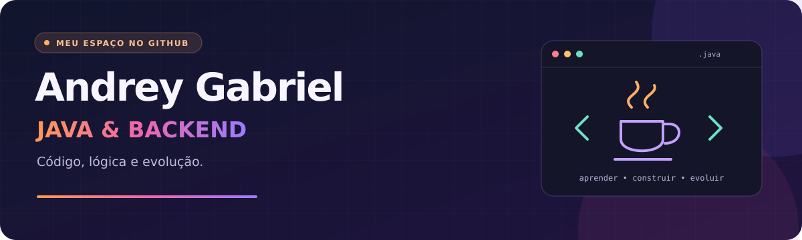

  

## Tecnologias

## Projetos

### [Jogo da Forca](https://github.com/Andrey-Gabriel/Jogo-da-Forca---Java)

Jogo de terminal em Java, com categorias de palavras, controle de tentativas e organização em classes.

### [Assistência técnica UCB](https://github.com/Andrey-Gabriel/assistencia-tecnica-ucb)

[Ver repositório](https://github.com/Andrey-Gabriel/assistencia-tecnica-ucb)
